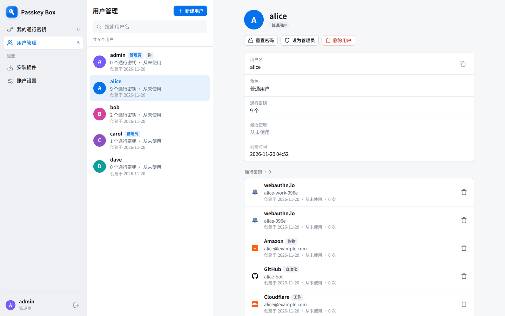
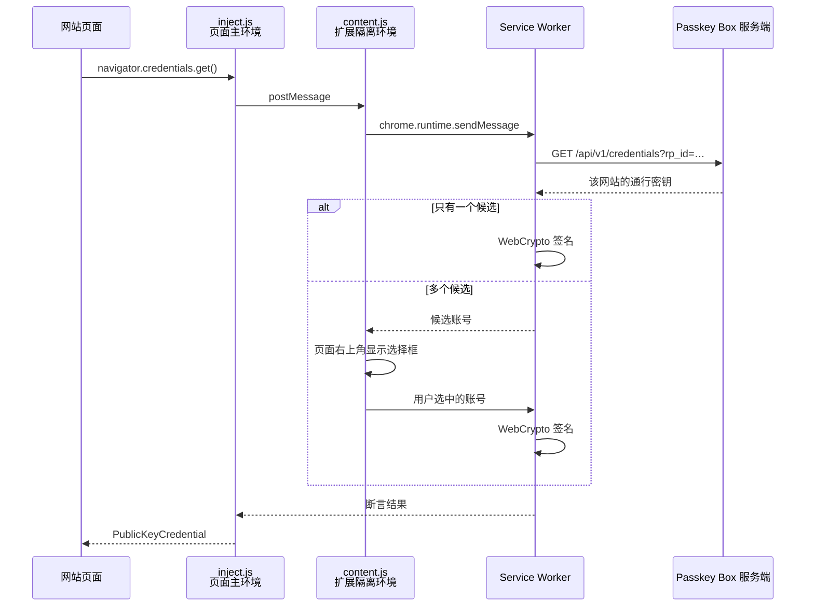

<p align="center">
  
</p>

<h1 align="center">Passkey Box</h1>

<p align="center">
  <strong>自托管的通行密钥（Passkey）管理器</strong>
  <br />
  Chrome 扩展接管网站的通行密钥注册与登录，密钥统一存放在你自己的服务器上。
  <br />
  只匹配到一个账号就直接登录，有多个账号才让你选，全程不弹系统指纹。
</p>

<p align="center">
  <a href="https://github.com/riba2534/passkey-box/actions/workflows/ci.yml"></a>
  <a href="https://go.dev/"></a>
  <a href="https://developer.chrome.com/docs/extensions/develop/migrate/what-is-mv3"></a>
  
  <a href="https://github.com/riba2534/passkey-box/stargazers"></a>
  <a href="LICENSE"></a>
</p>

<p align="center">
  <a href="#passkey-box-是什么">介绍</a> ·
  <a href="#功能总览">功能</a> ·
  <a href="#快速开始">快速开始</a> ·
  <a href="#使用说明">使用说明</a> ·
  <a href="#工作原理">工作原理</a> ·
  <a href="#配置">配置</a> ·
  <a href="#开发与测试">开发</a> ·
  <a href="#faq">FAQ</a>
</p>

<p align="center">
  
</p>

---

> [!WARNING]
> **Passkey Box 面向测试与自用场景，刻意不做安全设计。** 私钥以明文保存在服务端，扩展不加锁、不二次确认，签名时直接声明已完成用户验证。请只在你信任的环境里使用，不要用它保管重要账号。

## Passkey Box 是什么

Passkey Box 由两部分组成：

- **Chrome 扩展**：在网页调用 `navigator.credentials.create()` / `get()` 时接管请求，自己充当认证器完成签名，不经过操作系统，所以不会弹出指纹、Windows Hello 或手机扫码。
- **服务端**：Go 单二进制 + SQLite，多用户，带一个仿 1Password 风格的 Web 后台。扩展里填好服务器地址、用户名和密码，就能在任何一台电脑上使用这个账号下保存的全部通行密钥。

它适合这类场景：你有一批网站要用通行密钥批量登录，同一个网站下还有好几个账号；你希望登录时不被系统认证打断，也不想把密钥锁在某一台设备或某一家云服务里。

### 为什么选择 Passkey Box

- **不打断** — 只匹配到一个通行密钥时直接登录；网站一打开就发起的自动填充式请求，也能在页面加载时直接完成登录。
- **多账号清楚可控** — 网站指定了账号（先输用户名再登录）时精确匹配；同一网站有多个账号时，在页面右上角弹出 1Password 风格的选择框。
- **密钥在自己手里** — 通行密钥保存在你部署的服务器上，多台电脑、多个浏览器共用同一份数据；签名计数固定为 0，多端同时使用也不会冲突。
- **多用户 Web 后台** — 每个用户只能看到自己的通行密钥；管理员可以创建用户、重置密码，并查看所有用户的通行密钥。
- **部署简单** — 服务端是一个静态编译的二进制，`FROM scratch` 镜像，一个 SQLite 文件就是全部数据。
- **随时回到系统方式** — 对话框里点「使用其他方式」，请求原样交还给浏览器原生实现。

## 功能总览

| 模块 | 能力 |
|---|---|
| **注册** | 网站创建通行密钥时自动生成并上传到服务端，不弹确认；同一网站同一账号重复注册会覆盖旧的；命中 `excludeCredentials` 时按规范返回 `InvalidStateError` |
| **登录** | 精确匹配 `allowCredentials`；单个候选直接签名；多个候选弹出选择框；支持 conditional mediation（页面打开即登录） |
| **认证器** | ES256（P-256）与 RS256；`none` 证明；BE/BS 备份标志置位；返回对象通过 `instanceof PublicKeyCredential`，实现 `toJSON()` 等 WebAuthn L3 方法 |
| **扩展界面** | 页面内选择框与提示条；弹出窗口按「当前网站 / 全部」列出通行密钥，可搜索、查看详情、删除；两个自动登录开关 |
| **Web 后台** | 我的通行密钥（按网站分组、搜索、备注、使用统计）、用户管理（管理员）、账户设置、插件下载与安装指引；适配手机宽度，可添加到手机主屏幕 |
| **服务端 API** | REST + JSON，Basic 认证或会话 Cookie，详见 [docs/API.md](docs/API.md) |

### 界面预览

<table>
  <tr>
    <td width="50%"></td>
    <td width="50%"></td>
  </tr>
  <tr>
    <td align="center"><sub>我的通行密钥：按网站分组，右侧查看详情、编辑备注</sub></td>
    <td align="center"><sub>用户管理：管理员查看每个用户的通行密钥</sub></td>
  </tr>
</table>

## 快速开始

### 1. 部署服务端

需要一台能被你的浏览器访问到的机器。三种方式任选其一。

**Docker**

```bash
git clone https://github.com/riba2534/passkey-box.git && cd passkey-box
docker build -t passkey-box --build-arg VERSION=0.1.0 server
docker run -d --name passkey-box --restart unless-stopped \
  -p 8080:8080 \
  -e PKB_ADMIN_USERNAME=admin \
  -e PKB_ADMIN_PASSWORD=change-me \
  -v passkey-box-data:/data \
  passkey-box
```

**直接运行二进制**（需要 Go 1.26+、Node.js 22+）

```bash
make run    # 构建服务端和扩展安装包，在 http://127.0.0.1:8080 启动，管理员 admin / admin
```

**部署到带 Caddy 的 Docker 主机**：`deploy/deploy.sh` 在本地编译、上传，在服务器上构建镜像并替换容器，健康检查失败自动回滚。

```bash
DEPLOY_HOST=ubuntu@your-host SSH_KEY=~/.ssh/id_ed25519 PUBLIC_URL=https://passkey.example.com ./deploy/deploy.sh
```

容器只监听 `127.0.0.1:18300`，由反向代理提供 HTTPS，Caddy 配置见 [deploy/Caddyfile.snippet](deploy/Caddyfile.snippet)。首次部署会在服务器上生成 `passkey-box.env`，里面是随机的管理员密码。

> [!TIP]
> 部署在公网时请走 HTTPS，并设置 `PKB_COOKIE_SECURE=true`。扩展用 HTTP Basic 认证访问服务端，局域网里用 HTTP 也能工作。

### 2. 创建用户

用管理员账号登录 Web 后台，在「用户管理」里点「新建用户」。每个用户的通行密钥彼此隔离。

### 3. 安装扩展

在 Web 后台的「安装插件」页下载安装包（服务端设置了 `PKB_EXTENSION_ZIP` 时可用），或者自己构建：

```bash
make zip-extension PKB_DEFAULT_SERVER_URL=https://passkey.example.com
# 生成 dist/passkey-box-extension.zip，登录表单里预填服务器地址
```

解压后打开 `chrome://extensions`，开启右上角的「开发者模式」，点「加载已解压的扩展程序」，选择解压出来的目录。

### 4. 登录扩展

点击工具栏上的 Passkey Box 图标，填入服务器地址、用户名和密码。之后在任意网站注册或使用通行密钥，扩展都会自动处理。

## 使用说明

### 登录时用哪个账号

| 情况 | 行为 |
|---|---|
| 网站指定了凭据（先输用户名再登录，`allowCredentials` 非空） | 只在指定的凭据里匹配 |
| 只匹配到 1 个通行密钥 | 直接登录，右上角提示「已使用 xxx 登录」 |
| 匹配到多个通行密钥 | 弹出选择框，点哪个用哪个 |
| 一个也没有 | 提示未找到，可「使用其他方式」交给浏览器原生实现，或取消 |
| 页面打开时的自动填充式请求（conditional mediation） | 1 个候选直接登录；多个弹选择框；没有候选或服务器连不上时保持静默 |

### 注册

网站创建通行密钥时，扩展直接生成密钥并保存到服务端，右上角提示「通行密钥已保存」。同一网站、同一账号（相同 `user.id`）再次注册会覆盖旧的，不会留下重复项。

### 扩展设置

弹出窗口的「设置」里有两个开关，默认都打开：

- **只匹配到一个时自动登录**：关闭后，即使只有一个候选也会弹出选择框。
- **页面打开时自动登录**：关闭后，页面加载时发起的自动填充式请求不再自动完成。在只存了一个账号的网站上注册第二个账号前，可以先关掉它。

> [!NOTE]
> 已经登录扩展时，只有你在对话框里主动点「使用其他方式」，请求才会交给浏览器原生实现，也只有这时才可能出现系统认证。

## 工作原理



- `inject.js` 在 `document_start` 阶段注入页面主环境（MAIN world），替换 `CredentialsContainer.prototype.create/get`，并让能力检测方法返回「支持通行密钥」。这也是 1Password、Bitwarden 等浏览器扩展采用的做法；Chrome 没有提供让扩展充当通行密钥提供方的专用 API。
- `content.js` 运行在扩展的隔离环境，负责转发请求和绘制页面内界面（放在 open shadow root 里，不受页面样式影响）。
- Service Worker 读取配置、请求服务端，用 WebCrypto 生成密钥和签名，按 WebAuthn 规范拼出 `authenticatorData`、`clientDataJSON` 和 CBOR 编码的 `attestationObject`。

| 认证器参数 | 取值 |
|---|---|
| 算法 | ES256（优先）、RS256 |
| 证明格式 | `none` |
| 标志位 | 注册 `UP UV BE BS AT`，登录 `UP UV BE BS` |
| 签名计数 | 恒为 0，多端共用同一把密钥不会触发计数回退 |
| 凭据 ID | 32 字节随机数 |

## 配置

服务端通过环境变量配置：

| 变量 | 默认值 | 说明 |
|---|---|---|
| `PKB_LISTEN` | `:8080` | 监听地址 |
| `PKB_DB` | `./data/passkey-box.db` | SQLite 文件路径，目录不存在时自动创建 |
| `PKB_ADMIN_USERNAME` / `PKB_ADMIN_PASSWORD` | 空 | 启动时确保该管理员存在；已存在时只设为管理员，不改密码 |
| `PKB_ALLOW_REGISTER` | `false` | 是否允许在 Web 后台自助注册 |
| `PKB_COOKIE_SECURE` | `false` | 会话 Cookie 是否带 `Secure`，HTTPS 部署时设为 `true` |
| `PKB_EXTENSION_ZIP` | 空 | 扩展安装包路径，Web 后台「安装插件」页提供下载 |

HTTP API 的完整说明见 [docs/API.md](docs/API.md)：认证方式、错误格式、凭据与用户管理接口。

## 开发与测试

```bash
make test           # 服务端 go vet + go test，扩展类型检查 + 单元测试
make e2e            # 端到端测试：构建服务端和扩展，启动自带的测试网站，在 Chromium 里跑完整流程
make build          # 构建服务端二进制和扩展（extension/dist 可直接「加载已解压的扩展程序」）
make zip-extension  # 打包扩展
```

- **单元测试**：扩展的认证器输出用 [`@simplewebauthn/server`](https://simplewebauthn.dev/) 校验，覆盖 ES256 / RS256 的注册与登录。
- **端到端测试**：`e2e/` 自带一个用 `@simplewebauthn/server` 实现的测试网站，Playwright 加载真实扩展和服务端，覆盖自动登录、选择框、账号隔离、覆盖注册、回退到原生实现等场景，并用 Chrome 虚拟认证器断言已登录扩展时浏览器原生实现一次也没有被调用。
- CI 在每次推送和 PR 上运行以上全部测试。

```text
passkey-box/
├── server/        Go 服务端：REST API、SQLite 存储、内嵌 Web 后台
├── extension/     Chrome MV3 扩展（TypeScript + esbuild）
├── e2e/           Playwright 端到端测试与测试网站
├── deploy/        部署脚本与 Caddy 配置示例
├── docs/          API 文档、图片与品牌素材
└── scripts/       图标生成脚本
```

图标由 AI 生成的母版派生，替换方法见 [docs/brand](docs/brand/README.md)。

## FAQ

<details>
<summary><b>为什么不会弹出系统的指纹或 Windows Hello？</b></summary>

扩展在页面里接管了 WebAuthn 调用，由扩展自己签名，请求根本不会到达操作系统。只有你在对话框里点「使用其他方式」时，才会交给浏览器原生实现。

</details>

<details>
<summary><b>能和 1Password、Bitwarden 等扩展同时使用吗？</b></summary>

它们也会替换同一个 `navigator.credentials` 接口，同时启用会互相抢。使用 Passkey Box 时，请关闭其他密码管理器扩展的通行密钥功能。

</details>

<details>
<summary><b>保存在 Passkey Box 里的通行密钥能导入 1Password 吗？</b></summary>

数据层面是兼容的：Passkey Box 保存了凭据 ID、rpId、userHandle、用户名和 PKCS#8 私钥，与 FIDO 联盟的 [Credential Exchange Format](https://fidoalliance.org/specs/cx/cxf-v1.0-ps-errata-20260309.html) 中 passkey 条目的字段一致，签名计数也满足规范要求的 0。但 1Password 目前不支持从文件导入通行密钥，只能在 iOS/iPadOS 26 及以上通过系统的 Credential Exchange 在应用之间直接传输（见 [1Password 导入说明](https://support.1password.com/import/)），所以现在没有直接导入的路径。

</details>

<details>
<summary><b>哪些网站用不了？</b></summary>

要求硬件证明（attestation）或限定认证器型号（AAGUID 白名单）的网站会拒绝软件生成的通行密钥，常见于部分企业身份平台。大多数面向个人用户的网站接受 `none` 证明，可以正常使用。

</details>

<details>
<summary><b>同一个网站的多个账号能同时保持登录吗？</b></summary>

这取决于浏览器而不是通行密钥：同一个 Chrome 用户配置里，同一网站的 Cookie 是共享的，后登录的账号会顶掉前一个。需要同时在线时，可以为每个账号建一个 Chrome 用户配置，各自安装扩展、连接同一个服务端。

</details>

<details>
<summary><b>服务器连不上会怎样？</b></summary>

点击登录时会弹出错误提示，可以选择交给浏览器原生实现；页面加载时的自动填充式请求则保持静默，不会打扰你。

</details>

## 许可证

[MIT](LICENSE) © riba2534
