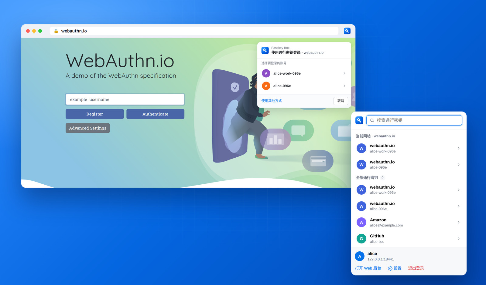
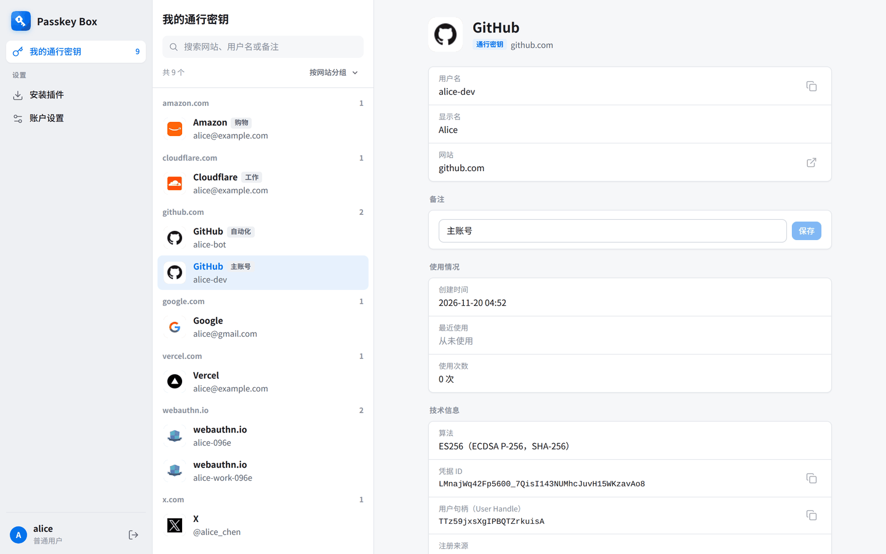
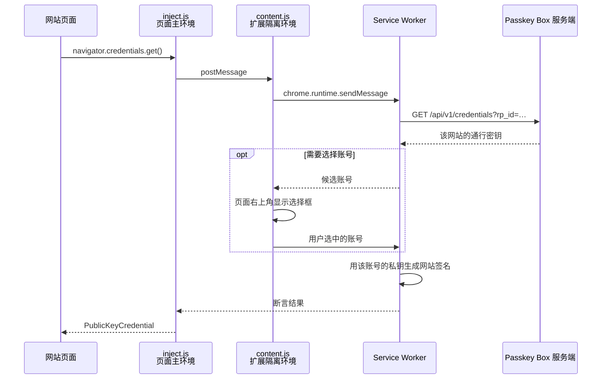

<p align="center">
  
</p>

<h1 align="center">Passkey Box</h1>

<p align="center">
  <strong>自托管的通行密钥（Passkey）管理器</strong>
  <br />
  Chrome 扩展接管网站的通行密钥注册与登录，密钥统一存放在你自己的服务器上。
  <br />
  自动匹配账号，直接完成网站登录。
</p>

<p align="center">
  <a href="https://github.com/riba2534/passkey-box/releases/latest"></a>
  <a href="https://github.com/riba2534/passkey-box/actions/workflows/ci.yml"></a>
  <a href="https://go.dev/"></a>
  <a href="https://developer.chrome.com/docs/extensions/develop/migrate/what-is-mv3"></a>
  
  <a href="https://github.com/riba2534/passkey-box/stargazers"></a>
  <a href="LICENSE"></a>
</p>

<p align="center">
  <a href="#passkey-box-是什么">介绍</a> ·
  <a href="#功能总览">功能</a> ·
  <a href="#快速开始">快速开始</a> ·
  <a href="#使用说明">使用说明</a> ·
  <a href="#工作原理">工作原理</a> ·
  <a href="#配置">配置</a> ·
  <a href="#开发与测试">开发</a> ·
  <a href="#faq">FAQ</a>
</p>

<p align="center">
  
</p>

---

> [!WARNING]
> **请保护 Passkey Box 服务端和账号。** Passkey Box 的用户名和密码是唯一的保护：扩展登录后直接生成网站凭据和签名，不再做设备或生物识别验证。凭据私钥以明文保存在服务端，拿到账号密码或私钥的一方都可以替你登录网站。

## Passkey Box 是什么

Passkey Box 由两部分组成：

- **Chrome 扩展**处理顶层网页的 WebAuthn 请求，用服务器上的私钥生成网站凭据或签名。
- **服务端**使用 Go 和 SQLite，提供多用户凭据同步和 Web 管理后台。

同一台服务器可以同步多个网站和账号的通行密钥。

### 为什么选择 Passkey Box

- **自动匹配** — 只有一个通行密钥时直接签名，自动向网站提交。
- **多账号清楚可控** — 网站指定了账号（先输用户名再登录）时精确匹配；同一网站有多个账号时，在页面右上角弹出 1Password 风格的选择框。
- **密钥在自己手里** — 通行密钥保存在你部署的服务器上，多台电脑、多个浏览器共用同一份数据；签名计数固定为 0，多端同时使用也不会冲突。
- **多用户，可共享可转移** — 每个用户默认只看到自己的通行密钥；可以把某个网站账号共享给本站其他用户，或者直接把它转给别人。
- **完整的管理后台** — 管理员可以批量创建、编辑、停用、删除用户（删除时把账号交接给别人），对任何人的任何账号做共享和转移，并查看操作日志。
- **对 Agent 友好** — 访问 `/skill.md` 就是给 Agent 的 API 使用说明；用 API 令牌授权，令牌永远拿不到私钥。
- **部署简单** — 服务端是一个静态编译的二进制，`FROM scratch` 镜像，一个 SQLite 文件就是全部数据。
- **随时回到系统方式** — 对话框里点「使用其他方式」，请求原样交还给浏览器原生实现。

## 功能总览

| 模块 | 能力 |
|---|---|
| **注册** | 生成并保存通行密钥。同一网站同一账号重复注册会覆盖旧的。命中 `excludeCredentials` 时返回 `InvalidStateError`。 |
| **登录** | 按 `allowCredentials` 匹配，多个候选时优先本浏览器 Profile 用过的账号，否则选择账号；启动器可以限定只自动使用本浏览器 Profile 用过的账号。支持 conditional mediation。 |
| **认证器** | ES256（P-256）与 RS256；`none` 证明；BE/BS 备份标志置位；返回对象通过 `instanceof PublicKeyCredential`，实现 `toJSON()` 等 WebAuthn L3 方法 |
| **扩展界面** | 页面内选择框与提示条；弹出窗口按「当前网站 / 全部」列出通行密钥，可搜索、查看详情、删除；两个自动登录开关 |
| **条目编辑** | 网站名称、用户名、显示名可以改；每个条目可以添加文本、密码、网址、邮箱、电话、日期、多行文本、一次性密码（TOTP）等自定义字段，TOTP 字段直接显示当前验证码；网站重新注册同一账号时，改过的名称、备注和字段都会保留 |
| **共享与转移** | 把通行密钥共享给本站其他用户（对方的扩展可以直接用它登录），随时撤销；把所有权转给别人，可选保留自己的访问；管理员可以操作任何人的任何通行密钥 |
| **Web 后台** | 我的通行密钥（按网站分组、搜索、备注、使用统计、共享与转移、多选批量操作）、我的动态、Agent 接入、账户设置、插件下载与安装指引；适配手机宽度，可添加到手机主屏幕 |
| **管理后台** | 概览；用户管理（批量创建并生成密码、批量编辑、停用、重置密码、强制下线、删除并交接账号）；全部通行密钥（按主人、网站、共享状态筛选，批量转移、共享、删除）；操作日志 |
| **服务端 API** | REST + JSON，Basic 认证、API 令牌或会话 Cookie；批量接口全有或全无，支持 `dry_run` 预览。详见 [docs/API.md](docs/API.md)，面向 Agent 的说明见 `/skill.md` |

### 界面预览

<table>
  <tr>
    <td width="50%"></td>
    <td width="50%"></td>
  </tr>
  <tr>
    <td align="center"><sub>我的通行密钥：按网站分组，右侧查看详情、编辑备注</sub></td>
    <td align="center"><sub>用户管理：管理员查看每个用户的通行密钥</sub></td>
  </tr>
</table>

## 快速开始

### 1. 部署服务端

需要一台能被你的浏览器访问到的机器。三种方式任选其一。

**Docker**

```bash
git clone https://github.com/riba2534/passkey-box.git && cd passkey-box
docker build -t passkey-box --build-arg VERSION=0.1.0 server
docker run -d --name passkey-box --restart unless-stopped \
  -p 8080:8080 \
  -e PKB_ADMIN_USERNAME=admin \
  -e PKB_ADMIN_PASSWORD=change-me \
  -v passkey-box-data:/data \
  passkey-box
```

**直接运行二进制**（需要 Go 1.26+、Node.js 22+）

```bash
make run    # 构建服务端和扩展安装包，在 http://127.0.0.1:8080 启动，管理员 admin / admin
```

**部署到带 Caddy 的 Docker 主机**：`deploy/deploy.sh` 在本地编译、上传，在服务器上构建镜像并替换容器，健康检查失败自动回滚。

```bash
DEPLOY_HOST=ubuntu@your-host SSH_KEY=~/.ssh/id_ed25519 PUBLIC_URL=https://passkey.example.com ./deploy/deploy.sh
```

容器只监听 `127.0.0.1:18300`，由反向代理提供 HTTPS，Caddy 配置见 [deploy/Caddyfile.snippet](deploy/Caddyfile.snippet)。首次部署会在服务器上生成 `passkey-box.env`，里面是随机的管理员密码。

> [!TIP]
> 部署在公网时请走 HTTPS，并设置 `PKB_COOKIE_SECURE=true`。扩展用 HTTP Basic 认证访问服务端，局域网里用 HTTP 也能工作。

### 2. 创建用户

用管理员账号登录 Web 后台，在「用户管理」里点「新建用户」，或者用「批量创建」一次粘贴多个用户名，由服务端生成密码。每个用户的通行密钥默认彼此隔离，主人可以共享给别人。

### 3. 安装扩展

三种方式任选其一获取安装包：

- 从 [GitHub Releases](https://github.com/riba2534/passkey-box/releases/latest) 下载 `passkey-box-extension-<版本>.zip`，可用同名 `.sha256` 文件校验；
- 在 Web 后台的「安装插件」页下载（服务端设置了 `PKB_EXTENSION_ZIP` 时可用，登录表单里已预填服务器地址）；
- 自己构建：

```bash
make zip-extension PKB_DEFAULT_SERVER_URL=https://passkey.example.com
# 生成 dist/passkey-box-extension.zip，登录表单里预填服务器地址
```

解压后打开 `chrome://extensions`，开启右上角的「开发者模式」，点「加载已解压的扩展程序」，选择解压出来的目录。

### 4. 登录扩展

点击工具栏上的 Passkey Box 图标，填入服务器地址、用户名和密码。登录后即可使用，不需要其他设置。

从 v0.1.0 升级后，固定的扩展 ID 会创建一份新的本地扩展设置，请重新登录。服务器上的网站凭据可以继续使用。

## 使用说明

### 登录时用哪个账号

| 情况 | 行为 |
|---|---|
| 网站指定了凭据（先输用户名再登录，`allowCredentials` 非空） | 只在指定的凭据里匹配 |
| 只匹配到 1 个通行密钥 | 直接签名，自动提交给网站 |
| 匹配到多个，其中只有 1 个在本浏览器 Profile 注册或用过 | 视同只匹配到 1 个，直接用它签名（关闭「只有一个账号时跳过选择」后改为弹出选择框） |
| 匹配到多个通行密钥 | 选中账号后签名；本浏览器 Profile 注册或用过的排在前面，标有「本浏览器用过」 |
| 一个也没有 | 提示未找到，可「使用其他方式」交给浏览器原生实现，或取消 |
| 页面打开时的自动填充式请求（conditional mediation） | 只有 1 个候选时直接签名；多个候选时与上面相同。无候选或服务器不可用时保持静默。 |

启动器在 `managed-config.json` 里设置 `"autoLogin": "owned-only"` 时，上表中的直接签名只适用于本浏览器 Profile 注册或用过的通行密钥，其他账号即使是唯一候选也先弹出选择框，见[预置账号](#预置账号)。

候选里有别人共享来的通行密钥时，同样只有本浏览器 Profile 注册或用过的通行密钥会直接签名：共享来的账号第一次总是先弹出选择框，避免别人共享给你的账号让你在不知情时登录进去。选过一次后，下次直接登录。

扩展在本浏览器 Profile 的本地存储里记下在这里注册或登录用过的通行密钥 ID（最多 500 个，超出时淘汰最久没用的），不上传服务器，退出登录时一并清除。多个 Profile 共用一个 Passkey Box 账号时（例如 AnyBrowser 的多个身份），每个 Profile 直接登录自己注册的网站账号；在选择框里选中的账号也会记下。

### 注册

网站请求注册时，扩展直接生成密钥并保存到服务器。同一网站、同一账号（相同 `user.id`）再次注册会覆盖旧的。

### 编辑条目和自定义字段

在 Web 后台打开一个通行密钥：

- **名称**：点「编辑」可以修改网站名称（列表里的标题）、用户名和显示名。它们只用于显示，不影响登录。
- **自定义字段**：像 1Password 一样，可以给条目添加任意字段，可以排序和删除。可选类型有文本、密码、网址、邮箱、电话、日期、多行文本和一次性密码（TOTP）。
  - 密码默认隐藏，可以显示或复制。
  - TOTP 字段粘贴 2FA 的 base32 密钥或 `otpauth://` 链接后，会实时显示当前 6 位验证码和剩余秒数。扩展弹窗的详情里也能看到验证码。
- 网站重新注册同一个账号时，你改过的名称、备注和自定义字段都会保留。
- 被共享人能看到字段，但不能修改。

> [!NOTE]
> 自定义字段的值（包括密码和 TOTP 密钥）和条目的其他信息一样，对能看到这个条目的人可见：主人、被共享人、管理员，以及他们的 API 令牌。

### 共享与转移

在 Web 后台「我的通行密钥」里打开一个通行密钥：

- **共享**：选择本站的其他用户。对方的扩展会在这个网站上看到这个账号（标着「共享自 你的用户名」），第一次使用时在选择框里确认一次，之后就能直接登录；对方不能改备注、删除或再共享，可以自己「移除共享」。
- **转移**：把这个账号交给另一个用户，立即生效，不需要对方确认。默认你会失去访问，可以勾选保留访问（你变成被共享人）。其他人的共享保留。
- 在网站上重新注册同一个账号时，新的私钥不会自动给之前共享过的人，需要重新共享。
- 多选后可以批量共享、转移和删除；每个批量操作先显示预览，确认后才执行，要么全部成功，要么全部不生效。

> [!WARNING]
> 共享就是把私钥交给对方的扩展。撤销共享只能阻止对方以后再拉取，不能保证对方没有留存。只共享给你信任的人。

管理员在「全部通行密钥」里可以对任何人的任何账号做同样的操作；在「用户管理」里删除用户时，可以先把他的全部账号交接给另一个用户。所有共享、转移、删除和用户管理操作都记在「操作日志」里，每个用户也能在「我的动态」里看到和自己有关的记录。

### 让 Agent 管理 Passkey Box

1. 在 Web 后台「Agent 接入」页创建一个 API 令牌（可以设为只读、设置有效期），令牌明文只显示一次。
2. 把页面上的提示词发给 Agent，或者让它读取 `https://<你的服务器>/skill.md`。这份说明列出了全部接口、批量操作的约定和常用操作示例，也可以直接保存为 Claude Code 的技能（`~/.claude/skills/passkey-box/SKILL.md`）。
3. Agent 用 `Authorization: Bearer pkb_…` 调用接口。管理员的令牌能做管理员能做的所有事。

令牌拿不到通行密钥的私钥，也不能修改自己的密码或创建新令牌；不用时在「Agent 接入」页吊销。可写的令牌能把通行密钥共享或转移给别人，所以泄露的影响范围同样包括全部私钥；只需要查询时创建只读令牌。批量的转移、删除这类操作，说明里要求 Agent 先用 `dry_run` 预览并请你确认。

> [!IMPORTANT]
> 管理员的令牌能做管理员能做的一切，包括创建用户、重置别人的密码、转移通行密钥，所以拿到它的一方可以间接取得任何通行密钥。管理员令牌只交给完全信任的 Agent，只需要查询时创建只读令牌。

### 扩展设置

弹出窗口的「设置」里有两个开关，默认都打开：

- **只有一个账号时跳过选择**。关闭后，单候选也先打开选择框；多个候选时总是打开选择框，即使其中只有一个是本浏览器用过的。页面的自动填充请求只有一个候选时仍直接登录。
- **响应页面的自动填充请求**。打开后，当前标签页的自动填充请求也能带出 Passkey Box 的账号选择或直接登录。

> [!NOTE]
> 嵌入式页面的 WebAuthn 由浏览器原生实现处理。更换设备后，在新的浏览器 Profile 里重新登录即可。

### 预置账号

用 `--load-extension` 加载解压目录的启动器（例如 [AnyBrowser](https://github.com/riba2534/anybrowser)）可以在 `manifest.json` 旁放一个 `managed-config.json`：

```json
{ "serverUrl": "https://passkey.example.com", "username": "alice", "password": "…", "autoLogin": "owned-only" }
```

扩展每次启动时读取这个文件，账号三项齐全就用它登录，覆盖之前保存的账号；账号不完整时不登录，保留之前保存的账号，但 `autoLogin` 照样生效；文件不存在时一切保持原样。文件里是明文密码，请只放在当前用户可读的目录。

可选的 `autoLogin` 决定哪些通行密钥可以不经选择直接登录：

| 取值 | 行为 |
|---|---|
| `"any"`，缺省或无法识别时也按它处理 | 与未预置账号时相同，见[登录时用哪个账号](#登录时用哪个账号) |
| `"owned-only"` | 只自动使用在本浏览器 Profile 注册或用过的通行密钥。其他账号即使是唯一候选，也先弹出选择框，页面打开时的自动填充请求也一样；选过一次后，下次直接登录。两个设置开关照常生效。 |

多个 Profile 共用一个 Passkey Box 账号时（AnyBrowser 默认写入 `"owned-only"`），这样可以避免一个 Profile 静默登录成另一个 Profile 注册的网站账号。没有账号的 Profile 可以只写 `{ "autoLogin": "owned-only" }`（AnyBrowser 移除账号后就是这样做的），扩展继续使用上次登录的账号，并按 owned-only 处理。策略保存在扩展里：文件被移除后，扩展保留上次的账号和策略，退出登录也不清除策略；文件重新出现时以文件为准。策略为 `"owned-only"` 时，弹出窗口和选项页的设置里会显示一行说明。

## 工作原理



- `inject.js` 在 `document_start` 阶段注入页面主环境（MAIN world），替换 `CredentialsContainer.prototype.create/get`，并让能力检测方法返回「支持通行密钥」。这也是 1Password、Bitwarden 等浏览器扩展采用的做法；Chrome 没有提供让扩展充当通行密钥提供方的专用 API。
- `content.js` 运行在扩展的隔离环境，负责转发请求和绘制页面内界面（放在 open shadow root 里，不受页面样式影响）。
- Service Worker 核对请求来自顶层页面、rpId 属于该页面的域名，然后用 WebCrypto 生成网站凭据或签名。

| 认证器参数 | 取值 |
|---|---|
| 算法 | ES256（优先）、RS256 |
| 证明格式 | `none` |
| 标志位 | 注册返回 `UP UV BE BS AT`，登录返回 `UP UV BE BS` |
| 签名计数 | 恒为 0，多端共用同一把密钥不会触发计数回退 |
| 凭据 ID | 32 字节随机数 |

## 配置

服务端通过环境变量配置：

| 变量 | 默认值 | 说明 |
|---|---|---|
| `PKB_LISTEN` | `:8080` | 监听地址 |
| `PKB_DB` | `./data/passkey-box.db` | SQLite 文件路径，目录不存在时自动创建 |
| `PKB_ADMIN_USERNAME` / `PKB_ADMIN_PASSWORD` | 空 | 启动时确保该管理员存在；已存在时只设为管理员，不改密码 |
| `PKB_ALLOW_REGISTER` | `false` | 是否允许在 Web 后台自助注册 |
| `PKB_COOKIE_SECURE` | `false` | 会话 Cookie 是否带 `Secure`，HTTPS 部署时设为 `true` |
| `PKB_EXTENSION_ZIP` | 空 | 扩展安装包路径，Web 后台「安装插件」页提供下载 |

HTTP API 的完整说明见 [docs/API.md](docs/API.md)：认证方式、错误格式、凭据、共享与用户管理接口。

### 升级

服务端启动时会自动升级数据库结构。升级前先在数据库旁边留一份完整副本（例如 `data/passkey-box.pre-v1-20261123T010203Z.db`，日志里会打印路径），升级只增加表和列、不改写已有数据，失败时整体回滚并拒绝启动。旧版本的服务端可以直接打开升级后的数据库，回滚部署不需要恢复数据；但旧版本不认识「停用」，回滚后被停用的用户又能登录，回滚前请先重置他们的密码。从升级前的副本恢复的步骤见 [docs/API.md](docs/API.md#数据库升级)。已经安装的旧版扩展不需要升级就能继续使用，也能用别人共享来的通行密钥。

## 开发与测试

```bash
make test           # 服务端 go vet + go test，扩展类型检查 + 单元测试
make e2e            # 端到端测试：构建服务端和扩展，启动自带的测试网站，在 Chromium 里跑完整流程
make build          # 构建服务端二进制和扩展（extension/dist 可直接「加载已解压的扩展程序」）
make zip-extension  # 打包扩展
```

- **单元测试**：扩展的认证器输出用 [`@simplewebauthn/server`](https://simplewebauthn.dev/) 校验，覆盖 ES256 / RS256 的注册与登录。
- **端到端测试**使用本地网站、真实扩展、服务端和 Chromium 测试认证器，覆盖注册、登录、账号选择、要求 UV 的网站和浏览器原生回退。
- CI 在每次推送和 PR 上运行以上全部测试。

```text
passkey-box/
├── server/        Go 服务端：REST API、SQLite 存储、内嵌 Web 后台
├── extension/     Chrome MV3 扩展（TypeScript + esbuild）
├── e2e/           Playwright 端到端测试与测试网站
├── deploy/        部署脚本与 Caddy 配置示例
├── docs/          API 文档、图片与品牌素材
└── scripts/       图标生成脚本
```

图标由 AI 生成的母版派生，替换方法见 [docs/brand](docs/brand/README.md)。

## FAQ

<details>
<summary><b>为什么不会弹出系统的指纹或 Windows Hello？</b></summary>

扩展在页面里接管了 WebAuthn 调用，由扩展自己签名，请求根本不会到达操作系统。只有你在对话框里点「使用其他方式」时，才会交给浏览器原生实现。

</details>

<details>
<summary><b>能和 1Password、Bitwarden 等扩展同时使用吗？</b></summary>

它们也会替换同一个 `navigator.credentials` 接口，同时启用会互相抢。使用 Passkey Box 时，请关闭其他密码管理器扩展的通行密钥功能。

</details>

<details>
<summary><b>保存在 Passkey Box 里的通行密钥能导入 1Password 吗？</b></summary>

数据层面是兼容的：Passkey Box 保存了凭据 ID、rpId、userHandle、用户名和 PKCS#8 私钥，与 FIDO 联盟的 [Credential Exchange Format](https://fidoalliance.org/specs/cx/cxf-v1.0-ps-errata-20260309.html) 中 passkey 条目的字段一致，签名计数也满足规范要求的 0。但 1Password 目前不支持从文件导入通行密钥，只能在 iOS/iPadOS 26 及以上通过系统的 Credential Exchange 在应用之间直接传输（见 [1Password 导入说明](https://support.1password.com/import/)），所以现在没有直接导入的路径。

</details>

<details>
<summary><b>哪些网站用不了？</b></summary>

要求硬件证明（attestation）或限定认证器型号（AAGUID 白名单）的网站会拒绝软件生成的通行密钥，常见于部分企业身份平台。大多数面向个人用户的网站接受 `none` 证明，可以正常使用。

</details>

<details>
<summary><b>同一个网站的多个账号能同时保持登录吗？</b></summary>

这取决于浏览器而不是通行密钥：同一个 Chrome 用户配置里，同一网站的 Cookie 是共享的，后登录的账号会顶掉前一个。需要同时在线时，可以为每个账号建一个 Chrome 用户配置，各自安装扩展、连接同一个服务端。每个配置记得自己注册或用过的账号，登录时直接用它，不用每次选择。

</details>

<details>
<summary><b>服务器连不上会怎样？</b></summary>

点击登录时会弹出错误提示，可以选择交给浏览器原生实现；页面加载时的自动填充式请求则保持静默，不会打扰你。

</details>

## 许可证

[MIT](LICENSE) © riba2534
